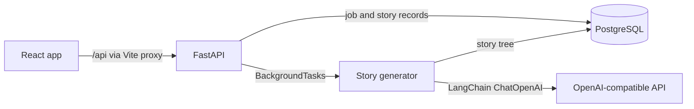

# AI Choose Your Own Adventure

Generate and play branching text adventures from a theme, using React, FastAPI, SQLAlchemy, PostgreSQL, and OpenAI.

## Screenshots


Screenshots are planned but are not included yet.

## Features

- Enter a theme to request a branching story (`frontend/src/components/ThemeInput.jsx`).
- Generate a story through a background task and track its status (`backend/routers/story.py`, `backend/routers/job.py`).
- Validate the model response against Pydantic story schemas (`backend/core/models.py`, `backend/core/story_generator.py`).
- Save story nodes and choices in SQLAlchemy models (`backend/models/story.py`).
- Play a story by selecting branches, restart it, or begin another (`frontend/src/components/StoryGame.jsx`).
- Show winning and non-winning endings (`frontend/src/components/StoryGame.jsx`).

## Tech Stack

- **Frontend:** React 19, React Router, Axios, Vite (`frontend/package.json`)
- **Backend:** Python, FastAPI, Pydantic, LangChain OpenAI (`backend/requirements.txt`)
- **Database:** SQLAlchemy ORM; PostgreSQL in Compose; SQLite supported in debug mode (`backend/db/database.py`, `backend/core/config.py`)
- **DevOps:** Docker Compose, Dockerfiles, PostgreSQL health check
- **AI:** OpenAI-compatible chat model `gpt-4o-mini` (`backend/core/story_generator.py`)

## Architecture

The React app sends requests to Vite's `/api` proxy. FastAPI creates a job record, runs generation with an in-process `BackgroundTasks` task, and stores the story tree through SQLAlchemy. The generator calls the OpenAI chat API or a configured OpenAI-compatible endpoint. There is no separate queue service.



## Run Locally

### Prerequisites

- Docker Desktop with Docker Compose.
- An OpenAI API key. The backend requires `OPENAI_API_KEY`; generation needs a working OpenAI-compatible service.

### Start the app

1. Create the local environment file:

   ```sh
   cp .env.example .env
   ```

2. Edit `.env` and set `OPENAI_API_KEY` to your own key. Keep the placeholder out of source control.

3. Build and start the API, frontend, and PostgreSQL:

   ```sh
   docker compose up --build
   ```

4. Open the frontend at [http://localhost:5173](http://localhost:5173). FastAPI Swagger UI is at [http://localhost:8000/docs](http://localhost:8000/docs).

5. Enter a theme such as `A lighthouse keeper discovers a door beneath the sea`. Wait for generation, then select story choices.

Stop the containers with `Ctrl+C`. Remove the database volume only when you intend to delete stored stories: `docker compose down -v`.

### Environment variables

| Variable | Default / example | Purpose |
| --- | --- | --- |
| `API_PREFIX` | `/api` | Prefix for story and job routes. |
| `DEBUG` | `false` | Enables the SQLite configuration when true. Compose uses PostgreSQL. |
| `DATABASE_URL` | blank | SQLAlchemy URL; blank lets the backend build PostgreSQL URL from `DB_*`. |
| `DB_USER` | `story_user` | PostgreSQL username. |
| `DB_PASSWORD` | `replace_with_a_local_password` | PostgreSQL password. |
| `DB_HOST` | `localhost` locally; Compose sets `db` | PostgreSQL host. |
| `DB_PORT` | `5432` | PostgreSQL port. |
| `DB_NAME` | `story_db` | PostgreSQL database name. |
| `ALLOWED_ORIGINS` | `[]` | JSON array or comma-separated browser origins for CORS. |
| `OPENAI_API_KEY` | `replace_with_your_key` | Required by backend settings and used for model calls. |
| `CHOREO_OPENAI_CONNECTION_SERVICEURL` | blank | Optional OpenAI-compatible base URL; used with the key when both are set. |

## API Overview

The default prefix is `/api` (`backend/core/config.py`). OpenAPI documentation is served at [`/docs`](http://localhost:8000/docs); ReDoc is at `/redoc`.

| Method | Path | Purpose |
| --- | --- | --- |
| `POST` | `/api/stories/create` | Create a generation job from a `theme`; returns job status and ID. |
| `GET` | `/api/jobs/{job_id}` | Read the current job status and generated `story_id` when complete. |
| `GET` | `/api/stories/{story_id}/complete` | Return the story root and all stored nodes. |

Example request to `POST /api/stories/create`:

```json
{"theme":"A lighthouse keeper discovers a door beneath the sea"}
```

Example response shape (timestamps and ID are illustrative):

```json
{
  "job_id": "<job-uuid>",
  "status": "pending",
  "created_at": "<timestamp>",
  "story_id": null,
  "completed_at": null,
  "error": null
}
```

## Design Decisions

- Store each narrative node as a row and each node's choices as JSON (`backend/models/story.py`); this supports loading the complete tree and moving between node IDs.
- Return a job ID before generation finishes, then let the frontend poll the job endpoint (`backend/routers/story.py`, `frontend/src/components/StoryGenerator.jsx`).
- Keep generation in FastAPI `BackgroundTasks`; the repository has no message broker or worker service (`backend/routers/story.py`).

## Status & Next Steps

- The UI and API flow are present, but full generation depends on valid model credentials and an available OpenAI-compatible API.
- The frontend only repeats job polling after it receives `processing`; an initial `pending` response can leave generation waiting indefinitely (`frontend/src/components/StoryGenerator.jsx`).
- Background tasks run in the API process and do not use a durable queue.
- There are no automated tests or database migrations in the repository.
- Add a root `.gitignore`: current ignore files are scoped to `backend/` and `frontend/`, so a root `.env` is not ignored.
- Add automated tests for job failures, tree persistence, and story navigation.

